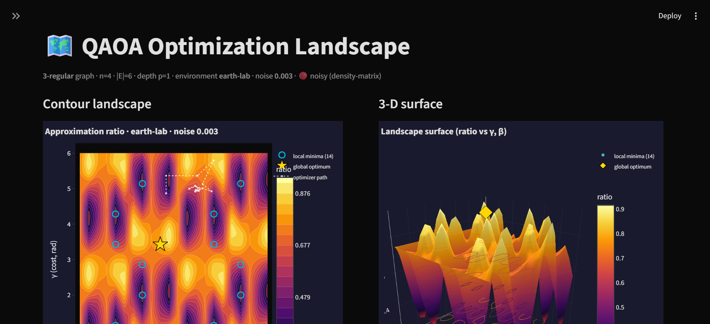
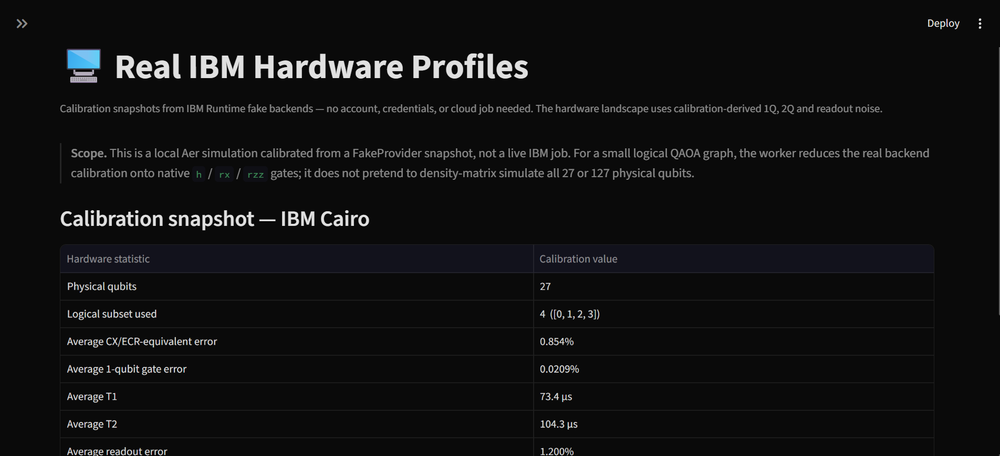
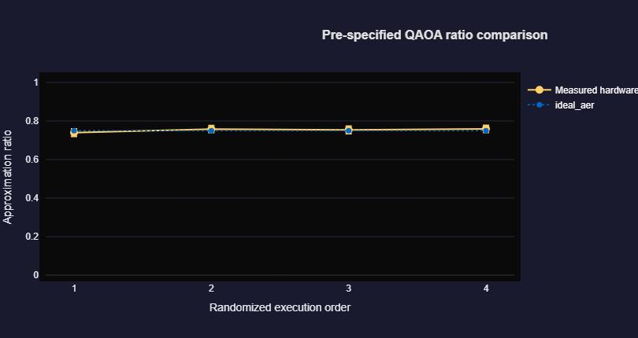
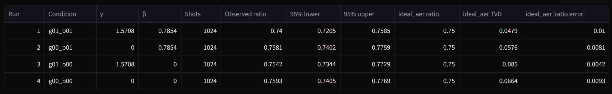
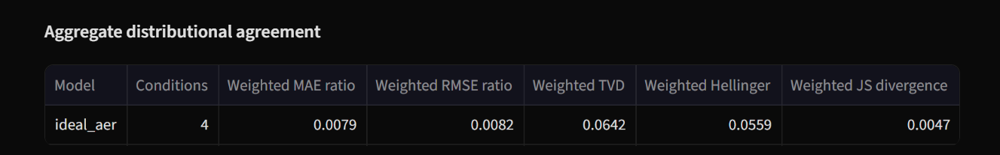
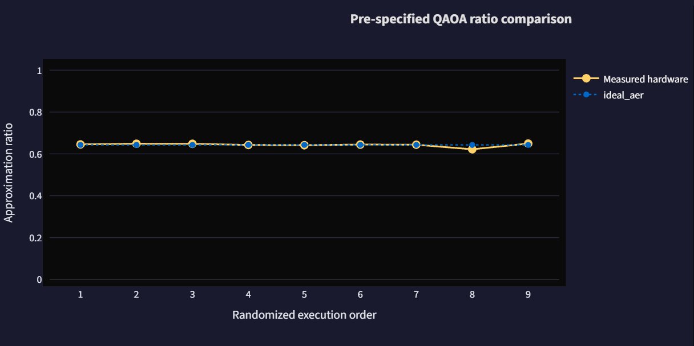
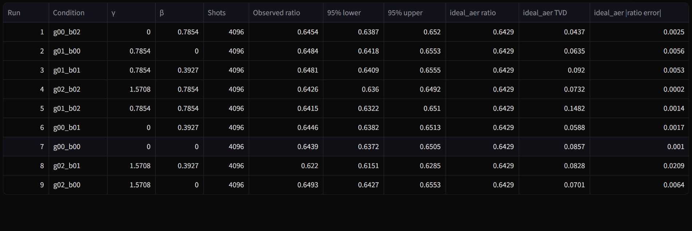
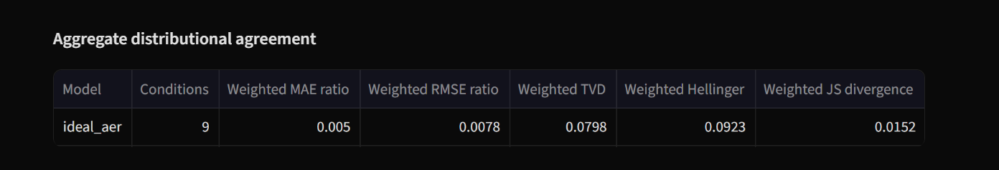

# 🧭 Quantum Compass

[](https://www.python.org/)
[](https://streamlit.io/)
[](https://qiskit.org/)
[](LICENSE)
[](#exports-and-reports)

**Quantum Compass is an interactive QAOA optimization-landscape navigator for MaxCut.** It makes the variational search surface visible: sweep the QAOA angles, locate peaks and traps, run multi-start optimizers, and compare the best achievable approximation ratio with classical baselines. The central control is a responsive noise-level slider, so an ideal landscape can be morphed into realistic terrestrial, hardware-calibrated, and space-environment landscapes without changing the problem instance.

**It is also a transparent diagnostic and planning toolkit rather than a black-box quantum-advantage claim.** The app uses deterministic Aer evaluations for smooth landscapes, isolates Qiskit execution in a persistent worker process, records approximation and feasibility assumptions for large studies, and exports reproducible data and reports. It includes radiation-/link-inspired environments, a landscape-fingerprinting classifier, fake-backend calibration profiles, and practical mission recommendations for small QAOA studies.

## Real application preview



*Actual Quantum Compass application capture: four-qubit 3-regular MaxCut, `p=1`, `earth-lab`, and noise level `0.003`. This figure demonstrates the interactive simulator interface; it is not a hardware measurement.*

The repository also retains a self-contained SVG preview at [`docs/assets/quantum-compass-preview.svg`](docs/assets/quantum-compass-preview.svg) for lightweight rendering contexts. The Docker-hosted Streamlit app is the interactive demonstration.

## ✨ Ten ways to use it

1. **🗺️ Landscape View** — render interactive 2-D contours and 3-D QAOA landscapes; mark global optima, local minima, and optimizer trajectories.
2. **📈 Noise Analysis** — sweep the key `0.000–0.100` noise slider, animate landscape deformation, fit monotone-vs-peak models, and report whether stochastic resonance is actually supported.
3. **🛰️ Space Mode** — compare Earth, LEO, satellite-to-ground, MEO/Van Allen, and deep-space profiles on the same graph and rank their robustness.
4. **🧭 Advantage Map** — compare fixed-angle QAOA against Goemans–Williamson, simulated annealing, or random-cut references across size and noise.
5. **🧊 Barren Plateau** — map variance, gradients, range, and trainability labels over qubit count and QAOA depth with explicit exact/transfer provenance.
6. **🖥️ Hardware Profiles** — use credential-free IBM Runtime FakeProvider calibration snapshots for Cairo, Kyoto, Sherbrooke, and Hanoi.
7. **🚀 Mission Planner** — turn a SPOQC-like, ISS, Lunar Gateway, Mars-orbiter, or custom profile into transparent operating, mitigation, risk, and advantage-window guidance.
8. **🧬 Landscape Fingerprinting** — upload a `gamma,beta,ratio` CSV or investigate five mystery landscapes; infer the closest simulated environment, confidence, top-three candidates, and weighted `p₂`/burst-rate estimates.
9. **📦 Reproducible outputs** — export CSV/NPZ/JSON, static PNG/SVG/PDF figures, and multi-page PDF reports without requiring a browser-installed Chrome runtime.
10. **🧪 Experimental Validation** — pre-specify a small QAOA hardware study, randomize circuit order, submit with IBM Runtime using your own credentials, upload measured counts, and quantify simulator agreement with bootstrap and full-distribution metrics.

## Real application gallery

Every image below is a reviewed capture from the running Docker-hosted application. They illustrate the interface and its documented simulator/planning workflows; they are not substitutes for the separately reported real-hardware evidence.

<table>
  <tr>
    <td width="50%" valign="top"><br/><strong>Noise analysis.</strong> A completed LEO-satellite sweep reports monotone degradation for this configuration rather than claiming resonance.</td>
    <td width="50%" valign="top"><br/><strong>Space Mode.</strong> A controlled same-instance comparison across documented environment profiles.</td>
  </tr>
  <tr>
    <td width="50%" valign="top"><br/><strong>Hardware profiles.</strong> A credential-free, calibration-derived simulator profile—not a live IBM job.</td>
    <td width="50%" valign="top"><br/><strong>Mission planning.</strong> Transparent QAOA planning and risk guidance, not flight certification.</td>
  </tr>
  <tr>
    <td width="50%" valign="top"><br/><strong>Fingerprinting.</strong> A controlled simulator-family diagnostic, not forensic attribution of arbitrary hardware.</td>
    <td width="50%" valign="top"><br/><strong>Experimental validation.</strong> A preregistration-first workflow with an explicit hardware-claim boundary.</td>
  </tr>
</table>

[**View the complete application gallery, including Landscape View, Advantage Map, and Barren Plateau workflows →**](docs/application_gallery.md)

## Quick start

> **Only have the release ZIP and want to run a real IBM Quantum validation study?** Follow the beginner-safe, platform-specific walkthrough in [`START_HERE_REAL_HARDWARE.md`](START_HERE_REAL_HARDWARE.md). It covers extraction, Python, Git preregistration, a dry-run pilot, credential-safe hardware submission, analysis, and evidence preservation. Prefer Docker rather than a local Python installation? Use [`DOCKER_HARDWARE_GUIDE.md`](DOCKER_HARDWARE_GUIDE.md).

### Local installation

```bash
# After cloning the repository from its GitHub page, enter the project directory.
cd quantum-compass

# A virtual environment is recommended.
python3.12 -m venv .venv
source .venv/bin/activate          # Windows PowerShell: .venv\Scripts\Activate.ps1
python -m pip install --upgrade pip
pip install -r requirements.txt

# Launch the interactive app.
streamlit run app.py
```

Open the URL printed by Streamlit (normally `http://localhost:8501`). Choose **🗺️ Landscape View**, select a graph and environment, then drag the **Noise level** slider. For fluid noisy density-matrix interaction, begin with graphs of eight qubits or fewer; the interface shows an ETA and offers explicit recomputation for heavier requests.

### Verify the installation

```bash
python -m pytest tests/test_core.py -q
python -m compileall -q app.py core utils pages tests
```

The bundled `data/fingerprint_model.pkl` is the pre-trained six-class RandomForest cache, so the first fingerprint classification does not need to generate 300 landscapes. If it is absent or incompatible, the app retrains it atomically using 50 deterministic landscapes per class.

## Environment models and methodology

QAOA encodes MaxCut with one qubit per graph vertex. At depth `p`, it alternates cost gates `RZZ(2γ)` on graph edges with mixer gates `RX(2β)` on qubits; the displayed surface is the approximation ratio `⟨C⟩ / C_max` over a gamma-beta grid. Ideal simulations use statevectors. Noisy simulations force Aer density matrices and reapply the readout channel on the exact distribution, preventing an accidental noise-free state-save path.

| Environment | Representative level | Main channels and interpretation |
|---|---:|---|
| `ideal` | 0.000 | Exact statevector reference |
| `earth-lab` | 0.003 | Depolarizing `p1/p2` plus symmetric readout error |
| `leo-satellite` | 0.008 | Elevated depolarization, 1% cosmic-ray bursts, +30% thermal modulation |
| `satellite-ground` | 0.005 | Elevation-dependent amplitude damping, phase damping, thermal population |
| `meo-van-allen` | 0.020 | Sustained radiation, stronger gate error, 3% bursts |
| `deep-space` | 0.050 | Unshielded cosmic-ray profile, strongest default error and 5% bursts |
| `custom` | — | User-supplied absolute channel probabilities |

For burst environments, each affected gate uses the specified mixture
`(1 − burst_rate) × Identity + burst_rate × Depolarizing(p=0.5)`. `core.noise_models.effective_params()` exposes all effective parameters without constructing Qiskit objects; `get_environment_info()` supplies description, channel values, citation, and mission context for every environment.

### Why the worker process matters

Streamlit reruns scripts after every widget interaction, while Qiskit/Aer objects involve native resources. Quantum Compass keeps all Qiskit circuit construction, noise-model creation, FakeProvider access, and Aer execution in a guarded persistent worker subprocess. The page process sends primitive graph/angle/noise descriptors only. This design keeps the slider safe across reruns and clearly separates interface state from simulation state.

## Space Mode and SPOQC-like mission studies

**🛰️ Space Mode** compares two to five noise environments on a shared QAOA instance. It renders comparable contours, noise-retention curves, a robustness ranking, and data-derived observations about degradation and angle shifts. It is intended to support sensitivity studies—not to replace radiation transport, orbital analysis, or a flight qualification campaign.

**🚀 Mission Planner** builds on the same models with editable templates for a **SPOQC-like LEO demonstrator**, ISS quantum payload, Lunar Gateway, and Mars orbiter. Given orbit, qubit technology, coherence times, gate fidelity, capacity, duration, and shielding, it emits four JSON-safe sections:

- environment assessment, including effective noise, radiation events/day, and thermal cycles/day;
- recommended QAOA strategy and mitigation stack;
- risk assessment with calibration/solar-event considerations; and
- an explicit small-problem quantum-advantage window.

The recommendation is an engineering heuristic grounded in the app's documented environment assumptions. It should be independently validated before any experimental or mission decision.

## Landscape fingerprinting

`core/fingerprint.py` turns a 2-D landscape into a stable 16-feature vector: variance, local extrema, peak width, roughness, gradient statistics, symmetry, range, kurtosis/skewness, entropy, neighbour autocorrelation, prominence, and edge/centre contrast. A deterministic six-class `RandomForestClassifier` is trained on ideal, Earth-lab, LEO, satellite-ground, MEO/Van Allen, and deep-space landscapes.

The supplied cache was trained with **50 landscapes per class** at `9×9` resolution. Its reproducible check classified six withheld calibration profiles correctly (`6/6`) and all five curated mystery landscapes correctly (`5/5`); out-of-bag score was `1.00` for this controlled synthetic family. These numbers are validation of the simulator-profile classifier only. A fingerprint result is a diagnostic clue, **not** forensic attribution of arbitrary physical hardware or a space asset. The full data provenance, intended-use boundary, feature contract, and failure modes are documented in [`docs/research/fingerprint_model_card.md`](docs/research/fingerprint_model_card.md).

### Input format

The fingerprint page accepts a complete long-form grid with numeric, finite values:

```csv
gamma,beta,ratio
0.000000,0.000000,0.500000
0.000000,0.349066,0.543210
0.000000,0.698132,0.601234
```

At least a complete `3×3` gamma-beta grid is required. Duplicate grid points are averaged; incomplete grids and malformed numeric cells result in a friendly validation error.

## Experimental validation: from simulator to evidence

The **🧪 Experimental Validation** page adds a deliberately conservative route from a simulation to an auditable real-hardware study. It does not manufacture a hardware result or present a simulation as an experiment.

1. Create a checksum-identified manifest that fixes a small graph, QAOA depth, gamma-beta grid, shots, bit convention, randomized execution order, primary endpoint, and distributional metrics before a run; commit it to a dated Git tag or research archive before a real submission if formal preregistration is needed.
2. Inspect the generated circuits without credentials:

   ```bash
   python scripts/submit_ibm_validation.py \
     --manifest qaoa_validation_manifest.json \
     --output-dir results/protocol_check \
     --dry-run
   ```

3. Set `IBM_QUANTUM_TOKEN` only in your shell, select a real IBM Quantum backend, and submit through the current client-side Runtime sampler (with a compatibility fallback for older supported clients). The CLI writes a token-free `submission_receipt.json` as soon as IBM returns a job ID, then writes normalized `counts_long.csv`, raw Qiskit counts, and job/compiler provenance—never the token. If a local process ends after a job ID is issued, recover it with `--job-id` rather than submit a duplicate job.
4. Upload the original manifest and measured counts to compare observed approximation ratios and count distributions against the ideal simulator; enable a FakeProvider-derived reference only when its snapshot is meaningful for the measured backend.

The analysis reports finite-shot bootstrap intervals, absolute ratio error, total variation distance, Hellinger distance, and Jensen–Shannon divergence. Its interpretation is intentionally narrow: agreement only measures predictive fit for the named circuits, backend, and time window. The full preregistration-style procedure, inclusion rules, data convention, and claim boundaries are in [`docs/research/experimental_validation_protocol.md`](docs/research/experimental_validation_protocol.md).

### Recover a job rather than submit twice

A remote Runtime job can continue after the local terminal or container exits. Keep the job ID from `submission_receipt.json`, restore the token only in the current shell, and retrieve the original job without resubmission:

```bash
python scripts/submit_ibm_validation.py \
  --manifest studies/descriptive-study-name/qaoa_validation_manifest.json \
  --backend your_backend_name \
  --job-id recorded_runtime_job_id \
  --output-dir studies/descriptive-study-name/backend_run
```

Recovery writes `job_recovery_receipt.json` and marks the run metadata as recovered. See [`REPRODUCIBILITY.md`](REPRODUCIBILITY.md) for full environment/checksum capture and study-evidence guidance.

### Completed IBM Quantum hardware-validation evidence

Quantum Compass has completed a real IBM Quantum hardware-validation progression on **`ibm_kingston`**: a four-qubit pipeline pilot followed by a pre-specified six-qubit final study. This is the repository’s strongest experimental evidence because it exercises the actual workflow end to end: manifest creation, preregistration, circuit construction, Runtime execution, count normalization, simulator comparison, uncertainty analysis, and evidence preservation.

| Study | Purpose and fixed protocol | Completion on `ibm_kingston` |
|---|---|---|
| **Pipeline pilot** | Four-qubit 3-regular/K4 MaxCut, `p=1`, 4 planned conditions, 1,024 shots per condition | **4 / 4** conditions; **4,096** observed shots |
| **Preregistered final study** | Six-qubit 3-regular MaxCut (`|E|=9`), `p=1`, fixed `3 × 3` angle grid, 4,096 shots per condition | **9 / 9** conditions; **36,864** observed shots |

The final manifest and protocol were frozen before final data collection under the annotated tag `qaoa-final-v1-preregistered`. Both studies retain their original manifests, dry-run plans, raw Qiskit counts, normalized vertex-order counts, run metadata, analysis exports, Docker-based environment records, and SHA-256 checksums: [`studies/pilot/`](studies/pilot/) and [`studies/final_v1/`](studies/final_v1/).

#### Hardware-versus-ideal Aer agreement

| Study | Weighted MAE ratio | Weighted RMSE ratio | Weighted TVD | Weighted Hellinger | Weighted JS divergence |
|---|---:|---:|---:|---:|---:|
| Four-qubit pipeline pilot | 0.00790 | 0.00820 | 0.06420 | 0.05590 | 0.00470 |
| Six-qubit preregistered final study | 0.00500 | 0.00780 | 0.07978 | 0.09230 | 0.01520 |

Below are the complete three-output result sets generated by the **Experimental Validation** page for both completed studies: the pre-specified ratio comparison, per-condition results, and aggregate distributional agreement. Click a visual to inspect its full-resolution source. In every ratio chart, orange is measured hardware and blue dotted is the ideal-Aer reference.

#### Four-qubit pipeline pilot — complete result set

The pilot tested a four-qubit 3-regular/K4 MaxCut instance at `p=1` across four planned angle conditions, each with 1,024 shots. It establishes that the operational workflow works on a real QPU before the larger final protocol: the manifested circuit plan, Runtime submission, count normalization, analysis, and evidence preservation all completed successfully.

**1. Pre-specified QAOA ratio comparison — 4 conditions**

[](docs/assets/hardware_validation/pilot_ibm_kingston_ratio_comparison.png)

**2. Per-condition results — 4 conditions, 1,024 shots each**

[](docs/assets/hardware_validation/pilot_ibm_kingston_condition_results.png)

**3. Aggregate distributional agreement — pilot**

[](docs/assets/hardware_validation/pilot_ibm_kingston_aggregate_metrics.png)

The pilot’s approximation-ratio errors ranged from **0.0042** to **0.0100** across the four retained conditions. It is an operational validation study, not a hardware-performance ranking or a substitute for the pre-specified final study.

#### Six-qubit preregistered final study — complete result set

The six-qubit 3-regular MaxCut study used a fixed `3 × 3` angle grid at `p=1`, 4,096 shots per condition, and retained all nine planned conditions. Its protocol and manifest were frozen before final data collection under `qaoa-final-v1-preregistered`.

**1. Pre-specified QAOA ratio comparison — 9 conditions**

[](docs/assets/hardware_validation/final_ibm_kingston_ratio_comparison.png)

**2. Per-condition results — 9 conditions, 4,096 shots each**

[](docs/assets/hardware_validation/final_ibm_kingston_condition_results.png)

**3. Aggregate distributional agreement — final study**

[](docs/assets/hardware_validation/final_ibm_kingston_aggregate_metrics.png)

The final study is the stronger confirmatory evidence. Ideal Aer predicted its observed approximation ratios closely (weighted mean absolute discrepancy **0.0050**, or about **0.5 percentage points**), while the per-condition and aggregate outputs transparently retain the non-zero full-distribution mismatch. In particular, the complete table retains the largest ratio discrepancy (`0.0209`) rather than selecting only visually favourable conditions.

This evidence supports a narrow, defensible conclusion: for these named circuit families, backend, compiler configurations, and execution windows, Quantum Compass’s ideal-Aer reference provided close objective-level predictions while preserving measurable distribution-level disagreement. It validates the project’s experimental-validation workflow on real hardware; it does **not** establish quantum advantage, a universal hardware-noise model, or physical-noise attribution. Read the complete [`hardware-validation results report`](docs/research/hardware_validation_results.md), [`experimental protocol`](docs/research/experimental_validation_protocol.md), and [`public release checklist`](docs/research/public_release_checklist.md) for provenance, metrics, and limitations.

## Exports and reports

`utils/export.py` provides both in-memory download helpers and file-based deliverables:

```python
from utils.export import (
    export_figure_png, export_figure_svg, export_figure_pdf,
    export_data_csv, export_report_pdf,
)

export_figure_png(figure, "exports/landscape.png")
export_figure_svg(figure, "exports/landscape.svg")
export_figure_pdf(figure, "exports/landscape.pdf")
export_data_csv(gammas, betas, ratios, "exports/landscape.csv")
export_report_pdf(params, results, [figure], "exports/analysis-report.pdf")
```

For Plotly figures, native Kaleido export is used when available. If a minimal deployment lacks Chrome—as can happen on Streamlit Community Cloud—the code falls back to a Matplotlib renderer for the common scatter, bar, heatmap, contour, and surface charts used by this app. The result remains a real static PNG/SVG/PDF rather than a broken download.

## Project structure

```text
quantum-compass/
├── app.py                         # landing page and guided navigation
├── core/
│   ├── graph_generator.py         # seeded graphs, MaxCut ground truth
│   ├── qaoa_builder.py            # QAOA ansatz
│   ├── qaoa_evaluator.py          # exact and sampled evaluation
│   ├── landscape.py               # gamma-beta sweep and extrema
│   ├── noise_models.py            # lab/space channels and citations
│   ├── fingerprint.py             # 16-feature RF diagnostics
│   ├── experimental_validation.py # manifest, counts validation and statistics
│   ├── hardware_profiles.py       # FakeProvider-derived models
│   ├── advantage_map.py           # fixed-angle comparison protocol
│   ├── barren_plateau.py          # trainability phase engine
│   ├── mission_planner.py         # transparent space-QAOA plans
│   └── aer_worker.py              # isolated persistent Aer worker
├── pages/                         # ten Streamlit pages, including hardware validation
├── scripts/
│   ├── submit_ibm_validation.py   # credential-gated Runtime submission/recovery CLI
│   └── capture_study_provenance.py # local environment + SHA-256 evidence capture
├── studies/                       # real study bundles; no generated hardware examples
├── utils/                         # plotting, analysis, CSV/JSON/PDF/static exports
├── data/fingerprint_model.pkl     # pre-trained default classifier cache
├── docs/
│   ├── application_gallery.md      # captioned real-app workflow gallery
│   ├── assets/                    # real app captures plus public-safe hardware visuals
│   └── research/                  # protocol, results, evidence layout, and future work
├── .github/workflows/tests.yml    # GitHub Actions regression checks
├── tests/test_core.py             # core regression suite
└── .streamlit/config.toml         # dark Streamlit theme and server settings
```

## Research basis

Three primary research strands inform the app:

1. **QAOA and combinatorial optimization** — E. Farhi, J. Goldstone, and S. Gutmann, *A Quantum Approximate Optimization Algorithm*, arXiv:1411.4028 (2014).
2. **Radiation-correlated errors in superconducting qubits** — A. Vepsäläinen *et al.*, *Impact of ionizing radiation on superconducting qubit coherence*, **Nature 584**, 551–556 (2020).
3. **Satellite quantum links** — S.-K. Liao *et al.*, *Satellite-to-ground quantum key distribution*, **Nature 549**, 43–47 (2017).

The in-app **📚 About** page includes these and seven additional references in copy-ready BibTeX, covering MaxCut approximation, error mitigation, variational methods, Van Allen environments, deep-space radiation, stochastic resonance, and IBM Runtime documentation.

## Citation

Machine-readable citation metadata is provided in [`CITATION.cff`](CITATION.cff). If you use Quantum Compass figures, datasets, methodology, or code, cite the tool and the relevant underlying environment/model literature:

```bibtex
@software{quantum_compass,
  title   = {Quantum Compass: QAOA Optimization Landscape Navigator},
  author  = {{Quantum Compass Contributors}},
  year    = {2026},
  url     = {https://quantum-compass.streamlit.app},
  note    = {Interactive QAOA, noise-environment, hardware-profile, and mission-planning toolkit}
}
```

## Run with Docker

The repository includes a production-oriented `Dockerfile`, `docker-compose.yml`, `.dockerignore`, and `.env.example`. The image uses Python 3.12, runs Streamlit as a non-root user, includes a health check, forwards stop signals safely with `tini`, and prepares a fingerprint-model cache compatible with the container's installed dependencies.

### Docker Compose — recommended

```bash
# From the repository root.
cp .env.example .env

docker compose up --build
```

Open [http://localhost:8501](http://localhost:8501). The first image build deliberately pre-trains the six-class fingerprint model inside the image, so it can take several minutes; ordinary subsequent starts use the persistent `quantum-compass-data` Docker volume and are fast.

```bash
# Check the container state and application health.
docker compose ps
docker compose logs -f quantum-compass

# Stop the service while retaining generated data/model caches.
docker compose down

# Remove the persistent application-data volume as well.
docker compose down --volumes
```

To expose the app on another host port, set `QC_PORT` in `.env`, for example `QC_PORT=8080`. Set `QUANTUM_COMPASS_GITHUB_URL` there if the About page should display the source-repository button. Do not place credentials in the image or commit `.env` / `.streamlit/secrets.toml` files.

### Standalone Docker commands

```bash
docker build --tag quantum-compass:latest .
docker run --rm --publish 8501:8501 --name quantum-compass quantum-compass:latest
```

The container health endpoint is `/_stcore/health`. A named data volume is recommended for standalone runs when advantage-map/plateau caches should persist:

```bash
docker volume create quantum-compass-data
docker run --rm --publish 8501:8501 \
  --volume quantum-compass-data:/app/data \
  --name quantum-compass quantum-compass:latest
```

## Deploy to GitHub and Streamlit Community Cloud

The committed `requirements.txt`, `.streamlit/config.toml`, `runtime.txt`, Docker files, and pre-trained fingerprint cache are deployment-ready. No browser or system Chrome package is required for static Plotly exports.

### 1. Publish only after a privacy and evidence audit

Keep the repository private while it is being polished. Before changing visibility or creating a public release, follow [`RELEASE.md`](RELEASE.md) and [`docs/research/public_release_checklist.md`](docs/research/public_release_checklist.md). In particular, inspect the entire commit history for credentials, account information, local paths, and author-email privacy; verify the preregistration tag and raw study evidence remain intact; and run the full test suite from the actual checkout.

For an existing GitHub repository, push the reviewed release commit and annotated tag first while it is still private. Only then change repository visibility if the audit is complete. Set the public description to **“Interactive QAOA optimization-landscape navigator for terrestrial, hardware, and space noise studies.”** Keep `data/fingerprint_model.pkl` under version control so visitors do not wait for first-run training.

### 2. Deploy the Streamlit app

1. Visit [share.streamlit.io](https://share.streamlit.io/) and sign in with the GitHub account that owns the repository.
2. Choose **Create app**, select the newly published `quantum-compass` repository, branch `main`, and main file path `app.py`.
3. Set the app URL/subdomain to **`quantum-compass`** to target `https://quantum-compass.streamlit.app`.
4. In **Advanced settings**, use Python **3.12** (also declared by `runtime.txt`).
5. Deploy. After the build finishes, open the app and check all ten entries in the sidebar.
6. In the deployed app's **Settings → Secrets**, optionally add `QUANTUM_COMPASS_GITHUB_URL` with the canonical repository URL copied from the GitHub repository page. The About page then exposes a source button.

If the desired Streamlit subdomain is already claimed, select the nearest available app URL and update the tool citation and GitHub README link to match the deployed address.

### 3. Post-deployment smoke test

- Move the Landscape View noise slider for `earth-lab`, `leo-satellite`, `satellite-ground`, `meo-van-allen`, and `deep-space`.
- Run one PDF export and one PNG/SVG/CSV export.
- Open **🧬 Fingerprinting**, analyze one mystery landscape, then upload a complete CSV produced by `export_data_csv`.
- Open **🖥️ Hardware Profiles**, **🚀 Mission Planner**, and **🧪 Experimental Validation**; confirm their export/protocol controls render correctly. Run the validation CLI in `--dry-run` mode before any real hardware submission.
- Set `QUANTUM_COMPASS_GITHUB_URL` if the About page should show the source-repository button.

## License

Quantum Compass is released under the [MIT License](LICENSE). It is provided for education, research prototyping, and transparent exploratory analysis without warranty. See `LICENSE` for the full terms.
