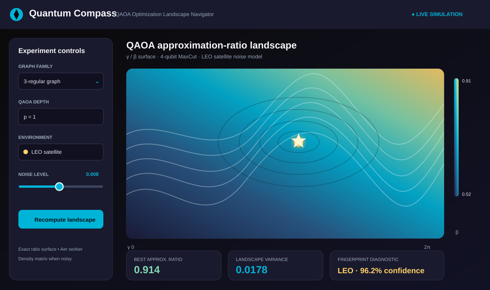

# 🧭 Quantum Compass

[](https://www.python.org/)
[](https://streamlit.io/)
[](https://qiskit.org/)
[](LICENSE)
[](#exports-and-reports)

**Quantum Compass is an interactive QAOA optimization-landscape navigator for MaxCut.** It makes the variational search surface visible: sweep the QAOA angles, locate peaks and traps, run multi-start optimizers, and compare the best achievable approximation ratio with classical baselines. The central control is a responsive noise-level slider, so an ideal landscape can be morphed into realistic terrestrial, hardware-calibrated, and space-environment landscapes without changing the problem instance.

**It is also a transparent diagnostic and planning toolkit rather than a black-box quantum-advantage claim.** The app uses deterministic Aer evaluations for smooth landscapes, isolates Qiskit execution in a persistent worker process, records approximation and feasibility assumptions for large studies, and exports reproducible data and reports. It includes radiation-/link-inspired environments, a landscape-fingerprinting classifier, fake-backend calibration profiles, and practical mission recommendations for small QAOA studies.

## Interface preview



The repository includes this self-contained SVG preview so it renders on GitHub without external assets. A deployed Streamlit session is the interactive demo; a screen-recorded GIF can be substituted for this preview in a project release or paper landing page.

## ✨ Ten ways to use it

1. **🗺️ Landscape View** — render interactive 2-D contours and 3-D QAOA landscapes; mark global optima, local minima, and optimizer trajectories.
2. **📈 Noise Analysis** — sweep the key `0.000–0.100` noise slider, animate landscape deformation, fit monotone-vs-peak models, and report whether stochastic resonance is actually supported.
3. **🛰️ Space Mode** — compare Earth, LEO, satellite-to-ground, MEO/Van Allen, and deep-space profiles on the same graph and rank their robustness.
4. **🧭 Advantage Map** — compare fixed-angle QAOA against Goemans–Williamson, simulated annealing, or random-cut references across size and noise.
5. **🧊 Barren Plateau** — map variance, gradients, range, and trainability labels over qubit count and QAOA depth with explicit exact/transfer provenance.
6. **🖥️ Hardware Profiles** — use credential-free IBM Runtime FakeProvider calibration snapshots for Cairo, Kyoto, Sherbrooke, and Hanoi.
7. **🚀 Mission Planner** — turn a SPOQC-like, ISS, Lunar Gateway, Mars-orbiter, or custom profile into transparent operating, mitigation, risk, and advantage-window guidance.
8. **🧬 Landscape Fingerprinting** — upload a `gamma,beta,ratio` CSV or investigate five mystery landscapes; infer the closest simulated environment, confidence, top-three candidates, and weighted `p₂`/burst-rate estimates.
9. **📦 Reproducible outputs** — export CSV/NPZ/JSON, static PNG/SVG/PDF figures, and multi-page PDF reports without requiring a browser-installed Chrome runtime.
10. **🧪 Experimental Validation** — pre-specify a small QAOA hardware study, randomize circuit order, submit with IBM Runtime using your own credentials, upload measured counts, and quantify simulator agreement with bootstrap and full-distribution metrics.

## Quick start

> **Only have the release ZIP and want to run a real IBM Quantum validation study?** Follow the beginner-safe, platform-specific walkthrough in [`START_HERE_REAL_HARDWARE.md`](START_HERE_REAL_HARDWARE.md). It covers extraction, Python, Git preregistration, a dry-run pilot, credential-safe hardware submission, analysis, and evidence preservation. Prefer Docker rather than a local Python installation? Use [`DOCKER_HARDWARE_GUIDE.md`](DOCKER_HARDWARE_GUIDE.md).

### Local installation

```bash
# After cloning the repository from its GitHub page, enter the project directory.
cd quantum-compass

# A virtual environment is recommended.
python3.12 -m venv .venv
source .venv/bin/activate          # Windows PowerShell: .venv\Scripts\Activate.ps1
python -m pip install --upgrade pip
pip install -r requirements.txt

# Launch the interactive app.
streamlit run app.py
```

Open the URL printed by Streamlit (normally `http://localhost:8501`). Choose **🗺️ Landscape View**, select a graph and environment, then drag the **Noise level** slider. For fluid noisy density-matrix interaction, begin with graphs of eight qubits or fewer; the interface shows an ETA and offers explicit recomputation for heavier requests.

### Verify the installation

```bash
python -m pytest tests/test_core.py -q
python -m compileall -q app.py core utils pages tests
```

The bundled `data/fingerprint_model.pkl` is the pre-trained six-class RandomForest cache, so the first fingerprint classification does not need to generate 300 landscapes. If it is absent or incompatible, the app retrains it atomically using 50 deterministic landscapes per class.

## Environment models and methodology

QAOA encodes MaxCut with one qubit per graph vertex. At depth `p`, it alternates cost gates `RZZ(2γ)` on graph edges with mixer gates `RX(2β)` on qubits; the displayed surface is the approximation ratio `⟨C⟩ / C_max` over a gamma-beta grid. Ideal simulations use statevectors. Noisy simulations force Aer density matrices and reapply the readout channel on the exact distribution, preventing an accidental noise-free state-save path.

| Environment | Representative level | Main channels and interpretation |
|---|---:|---|
| `ideal` | 0.000 | Exact statevector reference |
| `earth-lab` | 0.003 | Depolarizing `p1/p2` plus symmetric readout error |
| `leo-satellite` | 0.008 | Elevated depolarization, 1% cosmic-ray bursts, +30% thermal modulation |
| `satellite-ground` | 0.005 | Elevation-dependent amplitude damping, phase damping, thermal population |
| `meo-van-allen` | 0.020 | Sustained radiation, stronger gate error, 3% bursts |
| `deep-space` | 0.050 | Unshielded cosmic-ray profile, strongest default error and 5% bursts |
| `custom` | — | User-supplied absolute channel probabilities |

For burst environments, each affected gate uses the specified mixture
`(1 − burst_rate) × Identity + burst_rate × Depolarizing(p=0.5)`. `core.noise_models.effective_params()` exposes all effective parameters without constructing Qiskit objects; `get_environment_info()` supplies description, channel values, citation, and mission context for every environment.

### Why the worker process matters

Streamlit reruns scripts after every widget interaction, while Qiskit/Aer objects involve native resources. Quantum Compass keeps all Qiskit circuit construction, noise-model creation, FakeProvider access, and Aer execution in a guarded persistent worker subprocess. The page process sends primitive graph/angle/noise descriptors only. This design keeps the slider safe across reruns and clearly separates interface state from simulation state.

## Space Mode and SPOQC-like mission studies

**🛰️ Space Mode** compares two to five noise environments on a shared QAOA instance. It renders comparable contours, noise-retention curves, a robustness ranking, and data-derived observations about degradation and angle shifts. It is intended to support sensitivity studies—not to replace radiation transport, orbital analysis, or a flight qualification campaign.

**🚀 Mission Planner** builds on the same models with editable templates for a **SPOQC-like LEO demonstrator**, ISS quantum payload, Lunar Gateway, and Mars orbiter. Given orbit, qubit technology, coherence times, gate fidelity, capacity, duration, and shielding, it emits four JSON-safe sections:

- environment assessment, including effective noise, radiation events/day, and thermal cycles/day;
- recommended QAOA strategy and mitigation stack;
- risk assessment with calibration/solar-event considerations; and
- an explicit small-problem quantum-advantage window.

The recommendation is an engineering heuristic grounded in the app's documented environment assumptions. It should be independently validated before any experimental or mission decision.

## Landscape fingerprinting

`core/fingerprint.py` turns a 2-D landscape into a stable 16-feature vector: variance, local extrema, peak width, roughness, gradient statistics, symmetry, range, kurtosis/skewness, entropy, neighbour autocorrelation, prominence, and edge/centre contrast. A deterministic six-class `RandomForestClassifier` is trained on ideal, Earth-lab, LEO, satellite-ground, MEO/Van Allen, and deep-space landscapes.

The supplied cache was trained with **50 landscapes per class** at `9×9` resolution. Its reproducible check classified six withheld calibration profiles correctly (`6/6`) and all five curated mystery landscapes correctly (`5/5`); out-of-bag score was `1.00` for this controlled synthetic family. These numbers are validation of the simulator-profile classifier only. A fingerprint result is a diagnostic clue, **not** forensic attribution of arbitrary physical hardware or a space asset. The full data provenance, intended-use boundary, feature contract, and failure modes are documented in [`docs/research/fingerprint_model_card.md`](docs/research/fingerprint_model_card.md).

### Input format

The fingerprint page accepts a complete long-form grid with numeric, finite values:

```csv
gamma,beta,ratio
0.000000,0.000000,0.500000
0.000000,0.349066,0.543210
0.000000,0.698132,0.601234
```

At least a complete `3×3` gamma-beta grid is required. Duplicate grid points are averaged; incomplete grids and malformed numeric cells result in a friendly validation error.

## Experimental validation: from simulator to evidence

The **🧪 Experimental Validation** page adds a deliberately conservative route from a simulation to an auditable real-hardware study. It does not manufacture a hardware result or present a simulation as an experiment.

1. Create a checksum-identified manifest that fixes a small graph, QAOA depth, gamma-beta grid, shots, bit convention, randomized execution order, primary endpoint, and distributional metrics before a run; commit it to a dated Git tag or research archive before a real submission if formal preregistration is needed.
2. Inspect the generated circuits without credentials:

   ```bash
   python scripts/submit_ibm_validation.py \
     --manifest qaoa_validation_manifest.json \
     --output-dir results/protocol_check \
     --dry-run
   ```

3. Set `IBM_QUANTUM_TOKEN` only in your shell, select a real IBM Quantum backend, and submit through Runtime `SamplerV2`. The CLI writes normalized `counts_long.csv`, raw Qiskit counts, and job/compiler provenance—never the token.
4. Upload the original manifest and measured counts to compare observed approximation ratios and count distributions against the ideal simulator; enable a FakeProvider-derived reference only when its snapshot is meaningful for the measured backend.

The analysis reports finite-shot bootstrap intervals, absolute ratio error, total variation distance, Hellinger distance, and Jensen–Shannon divergence. Its interpretation is intentionally narrow: agreement only measures predictive fit for the named circuits, backend, and time window. The full preregistration-style procedure, inclusion rules, data convention, and claim boundaries are in [`docs/research/experimental_validation_protocol.md`](docs/research/experimental_validation_protocol.md).

## Exports and reports

`utils/export.py` provides both in-memory download helpers and file-based deliverables:

```python
from utils.export import (
    export_figure_png, export_figure_svg, export_figure_pdf,
    export_data_csv, export_report_pdf,
)

export_figure_png(figure, "exports/landscape.png")
export_figure_svg(figure, "exports/landscape.svg")
export_figure_pdf(figure, "exports/landscape.pdf")
export_data_csv(gammas, betas, ratios, "exports/landscape.csv")
export_report_pdf(params, results, [figure], "exports/analysis-report.pdf")
```

For Plotly figures, native Kaleido export is used when available. If a minimal deployment lacks Chrome—as can happen on Streamlit Community Cloud—the code falls back to a Matplotlib renderer for the common scatter, bar, heatmap, contour, and surface charts used by this app. The result remains a real static PNG/SVG/PDF rather than a broken download.

## Project structure

```text
quantum-compass/
├── app.py                         # landing page and guided navigation
├── core/
│   ├── graph_generator.py         # seeded graphs, MaxCut ground truth
│   ├── qaoa_builder.py            # QAOA ansatz
│   ├── qaoa_evaluator.py          # exact and sampled evaluation
│   ├── landscape.py               # gamma-beta sweep and extrema
│   ├── noise_models.py            # lab/space channels and citations
│   ├── fingerprint.py             # 16-feature RF diagnostics
│   ├── experimental_validation.py # manifest, counts validation and statistics
│   ├── hardware_profiles.py       # FakeProvider-derived models
│   ├── advantage_map.py           # fixed-angle comparison protocol
│   ├── barren_plateau.py          # trainability phase engine
│   ├── mission_planner.py         # transparent space-QAOA plans
│   └── aer_worker.py              # isolated persistent Aer worker
├── pages/                         # ten Streamlit pages, including hardware validation
├── scripts/submit_ibm_validation.py # credential-gated Runtime submission CLI
├── utils/                         # plotting, analysis, CSV/JSON/PDF/static exports
├── data/fingerprint_model.pkl     # pre-trained default classifier cache
├── docs/
│   ├── assets/                    # README interface preview
│   └── research/                  # hardware-validation protocol and fingerprint model card
├── tests/test_core.py             # core regression suite
└── .streamlit/config.toml         # dark Streamlit theme and server settings
```

## Research basis

Three primary research strands inform the app:

1. **QAOA and combinatorial optimization** — E. Farhi, J. Goldstone, and S. Gutmann, *A Quantum Approximate Optimization Algorithm*, arXiv:1411.4028 (2014).
2. **Radiation-correlated errors in superconducting qubits** — A. Vepsäläinen *et al.*, *Impact of ionizing radiation on superconducting qubit coherence*, **Nature 584**, 551–556 (2020).
3. **Satellite quantum links** — S.-K. Liao *et al.*, *Satellite-to-ground quantum key distribution*, **Nature 549**, 43–47 (2017).

The in-app **📚 About** page includes these and seven additional references in copy-ready BibTeX, covering MaxCut approximation, error mitigation, variational methods, Van Allen environments, deep-space radiation, stochastic resonance, and IBM Runtime documentation.

## Citation

If you use Quantum Compass figures, datasets, methodology, or code, cite the tool and the relevant underlying environment/model literature:

```bibtex
@software{quantum_compass,
  title   = {Quantum Compass: QAOA Optimization Landscape Navigator},
  author  = {{Quantum Compass Contributors}},
  year    = {2026},
  url     = {https://quantum-compass.streamlit.app},
  note    = {Interactive QAOA, noise-environment, hardware-profile, and mission-planning toolkit}
}
```

## Run with Docker

The repository includes a production-oriented `Dockerfile`, `docker-compose.yml`, `.dockerignore`, and `.env.example`. The image uses Python 3.12, runs Streamlit as a non-root user, includes a health check, forwards stop signals safely with `tini`, and prepares a fingerprint-model cache compatible with the container's installed dependencies.

### Docker Compose — recommended

```bash
# From the repository root.
cp .env.example .env

docker compose up --build
```

Open [http://localhost:8501](http://localhost:8501). The first image build deliberately pre-trains the six-class fingerprint model inside the image, so it can take several minutes; ordinary subsequent starts use the persistent `quantum-compass-data` Docker volume and are fast.

```bash
# Check the container state and application health.
docker compose ps
docker compose logs -f quantum-compass

# Stop the service while retaining generated data/model caches.
docker compose down

# Remove the persistent application-data volume as well.
docker compose down --volumes
```

To expose the app on another host port, set `QC_PORT` in `.env`, for example `QC_PORT=8080`. Set `QUANTUM_COMPASS_GITHUB_URL` there if the About page should display the source-repository button. Do not place credentials in the image or commit `.env` / `.streamlit/secrets.toml` files.

### Standalone Docker commands

```bash
docker build --tag quantum-compass:latest .
docker run --rm --publish 8501:8501 --name quantum-compass quantum-compass:latest
```

The container health endpoint is `/_stcore/health`. A named data volume is recommended for standalone runs when advantage-map/plateau caches should persist:

```bash
docker volume create quantum-compass-data
docker run --rm --publish 8501:8501 \
  --volume quantum-compass-data:/app/data \
  --name quantum-compass quantum-compass:latest
```

## Deploy to GitHub and Streamlit Community Cloud

The committed `requirements.txt`, `.streamlit/config.toml`, `runtime.txt`, Docker files, and pre-trained fingerprint cache are deployment-ready. No browser or system Chrome package is required for static Plotly exports.

### 1. Publish the repository on GitHub

Create a new public GitHub repository named `quantum-compass`, then run from this project directory. The GitHub CLI path below creates the remote under the authenticated account and avoids hand-editing a repository URL:

```bash
git init
git add app.py core pages utils data docs tests .streamlit requirements.txt runtime.txt README.md LICENSE .gitignore
git commit -m "Release Quantum Compass"
git branch -M main
gh repo create quantum-compass --public --source=. --remote=origin --push
```

Alternatively, create the repository in the GitHub web interface and use the exact **“…or push an existing repository from the command line”** commands shown there. Set the repository description to **“Interactive QAOA optimization-landscape navigator for terrestrial, hardware, and space noise studies.”** Keep `data/fingerprint_model.pkl` under version control so visitors do not wait for first-run training.

### 2. Deploy the Streamlit app

1. Visit [share.streamlit.io](https://share.streamlit.io/) and sign in with the GitHub account that owns the repository.
2. Choose **Create app**, select the newly published `quantum-compass` repository, branch `main`, and main file path `app.py`.
3. Set the app URL/subdomain to **`quantum-compass`** to target `https://quantum-compass.streamlit.app`.
4. In **Advanced settings**, use Python **3.12** (also declared by `runtime.txt`).
5. Deploy. After the build finishes, open the app and check all ten entries in the sidebar.
6. In the deployed app's **Settings → Secrets**, optionally add `QUANTUM_COMPASS_GITHUB_URL` with the canonical repository URL copied from the GitHub repository page. The About page then exposes a source button.

If the desired Streamlit subdomain is already claimed, select the nearest available app URL and update the tool citation and GitHub README link to match the deployed address.

### 3. Post-deployment smoke test

- Move the Landscape View noise slider for `earth-lab`, `leo-satellite`, `satellite-ground`, `meo-van-allen`, and `deep-space`.
- Run one PDF export and one PNG/SVG/CSV export.
- Open **🧬 Fingerprinting**, analyze one mystery landscape, then upload a complete CSV produced by `export_data_csv`.
- Open **🖥️ Hardware Profiles**, **🚀 Mission Planner**, and **🧪 Experimental Validation**; confirm their export/protocol controls render correctly. Run the validation CLI in `--dry-run` mode before any real hardware submission.
- Set `QUANTUM_COMPASS_GITHUB_URL` if the About page should show the source-repository button.

## License

Quantum Compass is released under the [MIT License](LICENSE). It is provided for education, research prototyping, and transparent exploratory analysis without warranty. See `LICENSE` for the full terms.
