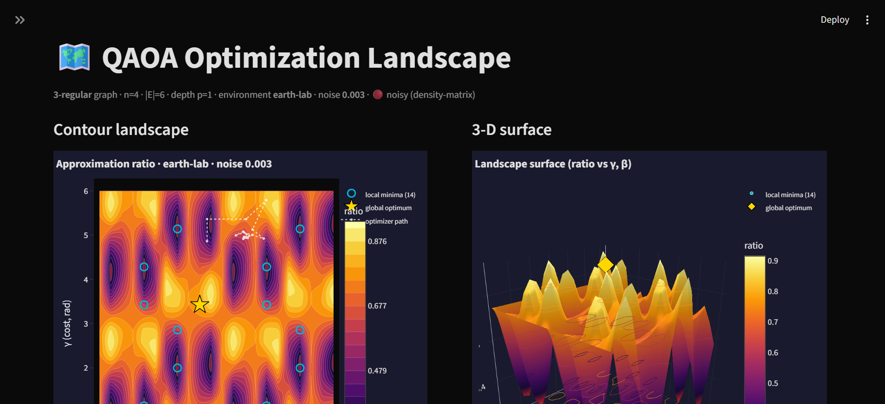
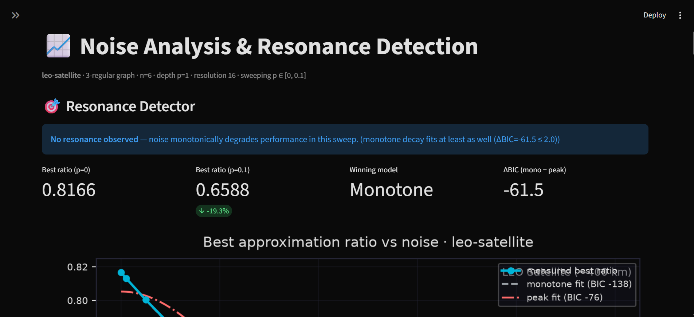
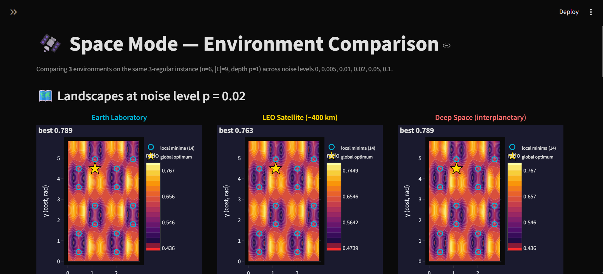
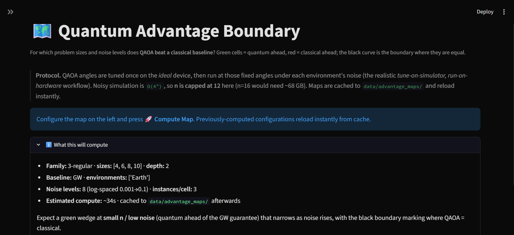
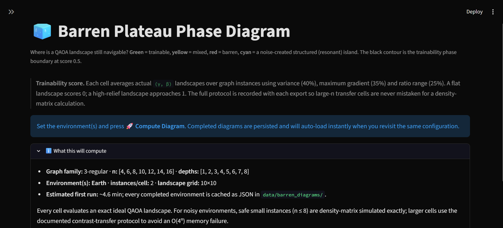
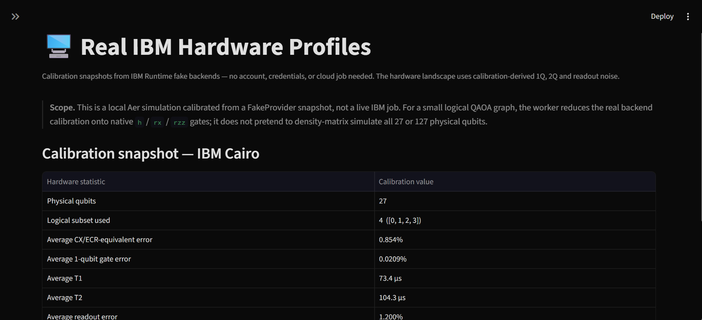
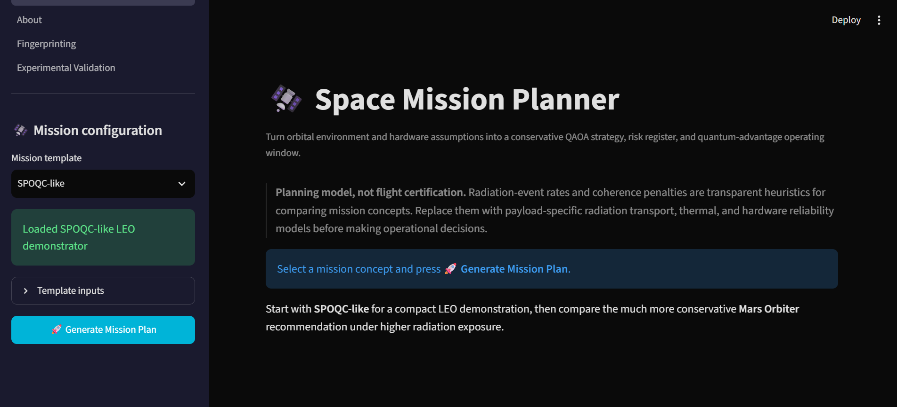
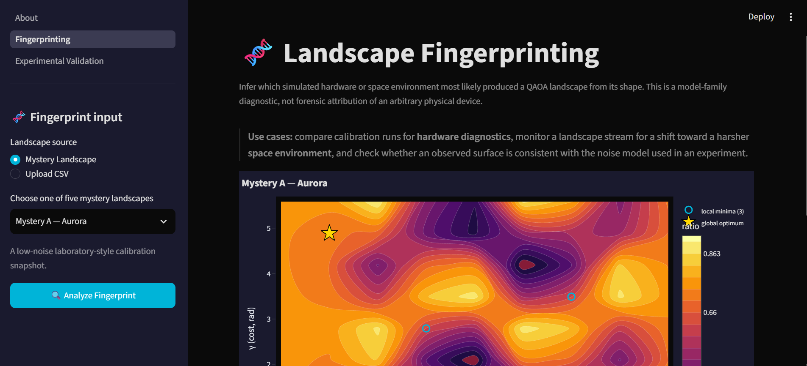
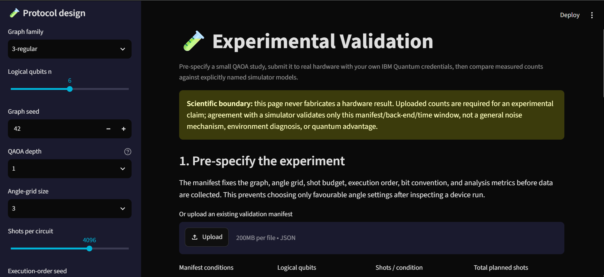

# Quantum Compass application gallery

All images in this gallery are real captures from the running Docker-hosted Quantum Compass Streamlit application. They are interface demonstrations, not fabricated mock-ups. The captures were reviewed to exclude browser chrome, local filesystem paths, account information, API keys, IBM dashboards, and personal profile data.

## Evidence boundary

The application contains both simulator/planning workflows and a real-hardware validation workflow. A screenshot of a simulator page is not hardware evidence. The completed IBM Quantum evidence is documented separately in [`research/hardware_validation_results.md`](research/hardware_validation_results.md), with its real aggregate-metrics and final ratio-comparison exports in [`assets/hardware_validation/`](assets/hardware_validation/README.md).

## QAOA landscape exploration

### Landscape View

A real `p=1` four-qubit 3-regular MaxCut simulation under the `earth-lab` profile at noise level `0.003`. The contour view identifies local minima and the global optimum while the paired 3-D surface makes the same optimization structure visible from a different angle.

### Noise Analysis and Resonance Detection

A completed LEO-satellite sweep. The displayed result reports no resonance for this configuration and shows the fitted monotone model alongside observed best-ratio values. This is an example of the app reporting a negative result rather than inferring a preferred narrative.

### Space Mode

A three-environment comparison on the same QAOA instance. The page is intended for controlled sensitivity studies across documented phenomenological environment profiles; it is not a flight qualification or physical-radiation measurement.

## Research-planning workflows

### Advantage Map

The configuration interface documents the fixed-angle, tune-on-simulator/run-under-noise comparison protocol and its computational limits before calculation. It does not itself demonstrate quantum advantage.

### Barren Plateau Phase Diagram

The diagram workflow records how variance, gradients, and ratio range contribute to a transparent trainability score. Large cells use the documented transfer protocol rather than being misrepresented as dense noisy simulations.

### Hardware Profiles

A credential-free calibration-derived simulator profile. It uses a FakeProvider snapshot and is explicitly labelled as a local Aer simulation rather than a live IBM job or live calibration feed.

### Space Mission Planner

The planner translates transparent assumptions into a conservative QAOA strategy and risk register. It is a research-planning heuristic, not flight certification or an operational mission decision.

### Landscape Fingerprinting

The fingerprinting workflow classifies controlled simulated environment families from landscape shape. Its documentation makes clear that this is not forensic attribution of arbitrary physical hardware or a space asset.

### Experimental Validation

The validation interface fixes a graph, angle grid, shot budget, execution order, bit convention, and metrics before data collection. The scientific-boundary notice states that uploaded counts are required for a hardware claim. See the separate [real-hardware results report](research/hardware_validation_results.md) for the completed `ibm_kingston` study.

## Reuse and publication rule

Use these captures as interface illustrations only. Preserve the captions and surrounding claim boundaries. Do not crop screenshots to remove methodological caveats, relabel simulator output as hardware evidence, or combine these visuals with IBM account/dashboard material. For asset-level provenance, see [`assets/application/README.md`](assets/application/README.md) and [`assets/hardware_validation/README.md`](assets/hardware_validation/README.md).
