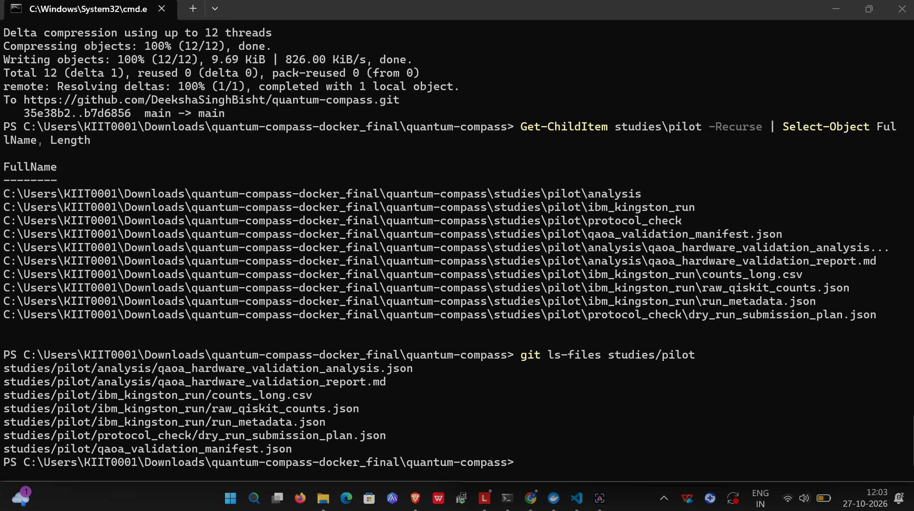
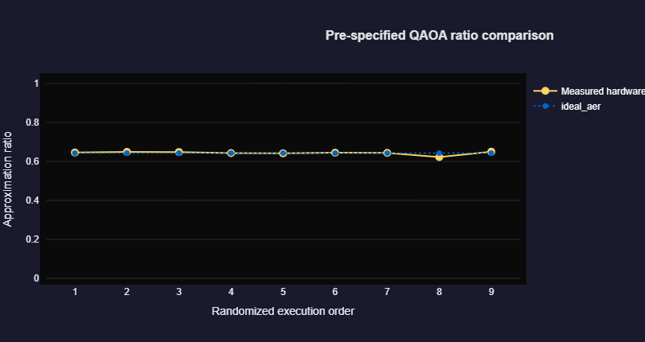

# Real-hardware QAOA validation results

> **Evidence status:** completed, small-scale hardware/simulation comparison. This document reports a narrowly scoped IBM Quantum result; it does not claim quantum advantage, a general device-noise model, or physical-noise attribution.

## Executive summary

Quantum Compass was used to pre-specify, dry-run, execute, and analyse a small QAOA MaxCut study on the IBM Quantum backend **`ibm_kingston`**. The main six-qubit study fixed a `3 × 3` QAOA angle grid before data collection and returned all nine planned conditions.

For this exact circuit family and execution period, the ideal Aer reference predicted the measured **approximation ratios** closely:

- weighted mean absolute ratio error: **0.00500** (0.50 percentage points);
- weighted root-mean-squared ratio error: **0.00780**.

The full computational-basis distributions were not identical to the ideal reference:

- weighted total-variation distance: **0.07978**;
- weighted Hellinger distance: **0.09230**;
- weighted Jensen–Shannon divergence: **0.01520**.

The useful conclusion is therefore deliberately two-part: ideal simulation was a close predictor of the objective-level ratio on this study, while detectable distribution-level disagreement remained.



## Study provenance

| Field | Value |
|---|---|
| Backend | `ibm_kingston` |
| Study type | pre-specified QAOA hardware/simulation comparison |
| Logical MaxCut graph | 3-regular, 6 vertices, 9 edges |
| QAOA depth | `p = 1` |
| Angle grid | `3 × 3` shared-angle grid |
| Planned / observed conditions | 9 / 9 |
| Shots per condition | 4,096 |
| Observed shots | 36,864 |
| Transpilation optimization level | 1 |
| Qiskit version recorded at retrieval | 2.6.1 |
| Stored count convention | vertex order (`character i = logical vertex i`) |
| Raw Runtime convention | Qiskit classical-bit order |
| Manifest ID | `3af2ae6317092dbcbf6a0dde42ee32d4305570f15160e173995ffa97ab408f6c` |
| IBM Runtime job ID | `dbfp1pfsstms73fec6q0` |
| Results retrieved (UTC) | 2026-10-27T05:46:05+00:00 |

The final manifest, study plan, dry-run circuit plan, raw Runtime counts, normalized counts, run metadata, analysis JSON, and generated Markdown report should be retained together under `studies/final_v1/`. The pre-data protocol was committed and tagged as `qaoa-final-v1-preregistered` before the final hardware results were collected.

## Protocol and integrity controls

The final protocol fixed the graph family, graph seed, QAOA depth, angle grid, shot budget, randomized execution order, bitstring convention, primary endpoint, and secondary metrics before hardware collection. A credential-free dry run confirmed the expected six-qubit, depth-one structure for every planned circuit:

```text
h:       6
rzz:     9
rx:      6
measure: 6
```

All nine returned conditions were included in the analysis. No angle setting, bitstring outcome, or unfavourable condition was removed after inspection. The zero-angle control remains part of the registered grid.

## Final model-agreement results

| Model | Conditions | Weighted MAE ratio | Weighted RMSE ratio | Weighted TVD | Weighted Hellinger | Weighted JS divergence |
|---|---:|---:|---:|---:|---:|---:|
| `ideal_aer` | 9 | 0.00500 | 0.00780 | 0.07978 | 0.09230 | 0.01520 |



*The horizontal axis preserves the preregistered randomized execution order. This objective-level figure is reported alongside—not instead of—the distributional metrics above.*

### Interpretation

The ratio-level metrics show close agreement: on average, the ideal prediction differed from the observed approximation ratio by roughly one half of a percentage point. The modestly larger RMSE relative to MAE is consistent with one or a few conditions contributing more strongly to the ratio mismatch than the rest; all planned conditions are retained in the result.

The non-zero full-distribution distances matter. A simulator can predict an expected MaxCut value closely while still failing to reproduce all individual bitstring probabilities. The final study therefore demonstrates why Quantum Compass reports total-variation, Hellinger, and Jensen–Shannon metrics alongside a single objective score.

No universal numerical cutoff determines whether a simulation is “true.” These values are effect sizes for this single protocol, not a pass/fail calibration test.

## Pilot-to-final progression

A four-qubit pilot first verified the operational pipeline on the same backend: manifest generation, dry run, IBM Runtime submission, count normalization, provenance capture, and analysis. It used four conditions with 1,024 shots per condition.

| Study | Logical qubits | Conditions | Shots / condition | Weighted MAE ratio | Weighted TVD |
|---|---:|---:|---:|---:|---:|
| Pipeline pilot | 4 | 4 | 1,024 | 0.0079 | 0.0642 |
| Final registered study | 6 | 9 | 4,096 | 0.0050 | 0.0798 |

These values should not be interpreted as a direct hardware-quality ranking: the graph, angle grid, and shot budget differ. The progression instead demonstrates that the complete workflow was first exercised on a small pilot and then executed on a more informative, pre-specified study.

## Limits and non-claims

This result is limited to the named backend, execution period, compiler configuration, six-qubit graph, `p = 1` ansatz, angle grid, and shot budget. In particular, it does **not** establish:

- quantum advantage over a classical MaxCut algorithm;
- a universal prediction guarantee for ideal simulation;
- an exact live calibration model for `ibm_kingston`;
- attribution to a specific physical noise process, radiation environment, or mission profile;
- transferability to another backend, day, graph family, QAOA depth, or mitigation stack.

Bootstrap intervals in the app quantify finite-shot uncertainty conditional on the observed counts. They do not capture calibration drift, queue-time effects, compiler variation, crosstalk, leakage, readout-mitigation uncertainty, or model misspecification.

## Reproduction checklist

1. Inspect `studies/final_v1/qaoa_validation_manifest.json` and the pre-data Git tag.
2. Review `studies/final_v1/protocol_check/dry_run_submission_plan.json`.
3. Audit any recorded submission/recovery receipt, raw counts, normalized `counts_long.csv`, and `run_metadata.json` under `studies/final_v1/ibm_kingston_run/`.
4. Capture `environment.json` and `SHA256SUMS.txt` from the actual final evidence checkout with `scripts/capture_study_provenance.py`; do not fabricate these later.
5. Re-upload the original manifest and normalized count CSV on the **Experimental Validation** page.
6. Keep the `vertex-order` convention, compare against `ideal_aer`, and retain every returned condition.
7. Compare regenerated results with the stored analysis JSON and Markdown report.

## Citation-ready portfolio statement

> Built and executed a reproducible small-QAOA hardware-validation study using IBM Quantum `ibm_kingston`. I pre-specified a six-qubit, nine-condition p=1 MaxCut protocol, preserved the manifest and raw counts, and compared observed distributions with an ideal Aer reference. The final study achieved weighted approximation-ratio MAE 0.0050 while retaining measurable distribution-level mismatch (weighted TVD 0.0798), demonstrating both model agreement and the limits of ideal simulation.
